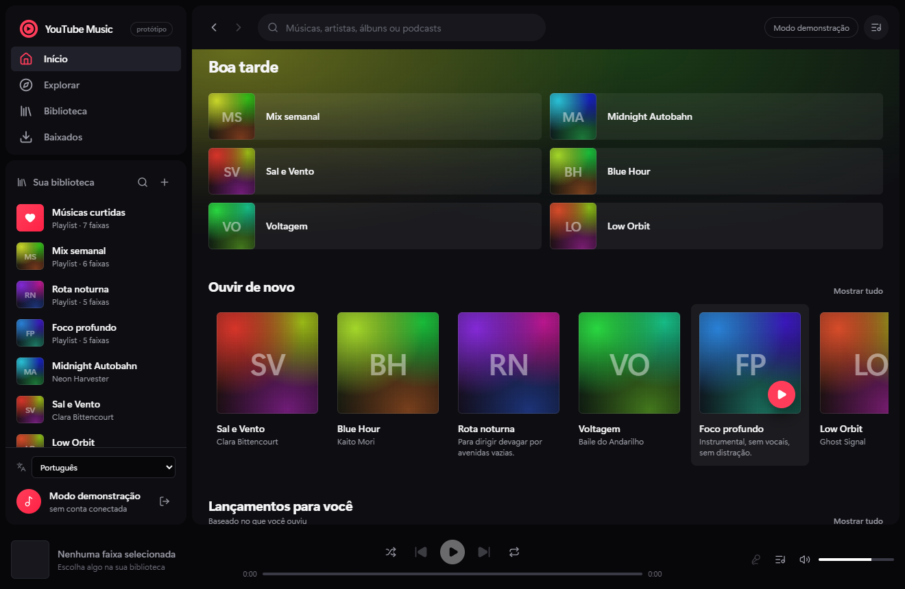
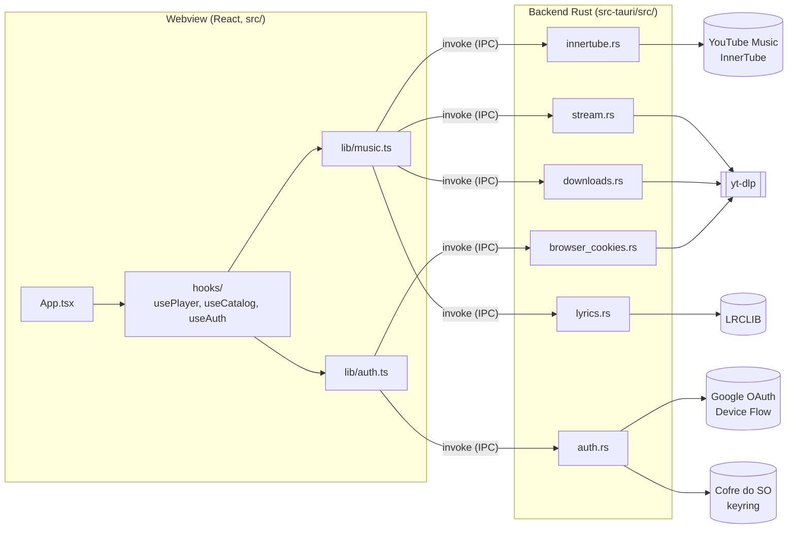

<div align="center">


# YTM Desktop

**Cliente desktop de YouTube Music para quem já vive no modelo do Spotify.**<br/>
Tauri 2 + React 19: catálogo e áudio reais no app; no navegador, um catálogo simulado para revisão offline.

[](https://github.com/juninmd/ytm-desktop/actions/workflows/ci.yml)
[](https://github.com/juninmd/ytm-desktop/actions/workflows/security.yml)
[](LICENSE)

<br/>



</div>

Cliente desktop de YouTube Music (protótipo) em **Tauri 2 + React 19 + Tailwind 4**, para quem já tem
no dedo o modelo de interação do Spotify: shell denso de três painéis, player com fila, busca,
biblioteca e letras. No app desktop, o catálogo e o áudio são reais (InnerTube + `yt-dlp`, ambos
implementados em Rust); no navegador, a interface cai para um catálogo simulado embutido, para ser
revisada offline e sem credenciais.

## Índice

- [Funcionalidades](#funcionalidades)
- [O que é real e o que não é](#o-que-é-real-e-o-que-não-é)
- [Arquitetura](#arquitetura)
- [Requisitos](#requisitos)
- [Instalação](#instalação)
- [Configuração](#configuração)
- [Uso](#uso)
- [Atalhos de teclado](#atalhos-de-teclado)
- [Testes, lint e build](#testes-lint-e-build)
- [Gates de CI](#gates-de-ci)
- [Estrutura do projeto](#estrutura-do-projeto)
- [Screenshots](#screenshots)
- [Terminal](#terminal)
- [Notas de design](#notas-de-design)
- [Acessibilidade](#acessibilidade)
- [Advisories conhecidos](#advisories-conhecidos)
- [Segurança](#segurança)
- [Limitações conhecidas](#limitações-conhecidas)
- [Documentação](#documentação)
- [Contribuição](#contribuição)
- [Licença](#licença)

## Funcionalidades

- Player com fila, shuffle, repetição e volume; máquina de estados em um único reducer.
- Áudio real: cada faixa é resolvida por `yt-dlp` em uma URL de stream, com cache até expirar e
  prefetch da próxima faixa.
- Catálogo YouTube Music (home, busca, álbuns, playlists e páginas de artista) sem precisar de conta.
- Busca com as abas do player web (músicas, álbuns, artistas, playlists).
- Autoplay/rádio: ao fim da fila, o rádio da faixa a continua (configurável na fila).
- Biblioteca pessoal (playlists, músicas curtidas, álbuns salvos) ao conectar o cookie do navegador.
- Curtir faixa com escrita na conta (otimista, com rollback); apenas local sem a biblioteca conectada.
- Letras sincronizadas estilo karaokê via [LRCLIB](https://lrclib.net), com texto simples do YouTube
  Music como fallback.
- Downloads offline com `yt-dlp`, tocados do disco pelo protocolo `asset`.
- Mídia em segundo plano e teclas de mídia pela Media Session API.
- Sessão restaurada **pausada** na próxima abertura (fila, faixa atual e posição).
- Interface bilíngue (pt-BR / inglês); a troca também muda o idioma dos dados do catálogo (`hl`).
- Login por OAuth 2.0 Device Flow no Rust; sair revoga a concessão.

## O que é real e o que não é

| Área | Status |
|---|---|
| Transporte, fila, shuffle, repetição, volume | Máquina de estados real; no desktop dirige um `<audio>` real |
| Áudio | **Real**: cada faixa é resolvida por `yt-dlp` em um stream tocável |
| Mídia em segundo plano e teclas de mídia | **Real**: a Media Session API alimenta o overlay do SO e as teclas |
| Catálogo (home, busca, álbum/playlist) | **Real** (InnerTube) no desktop; o preview filtra um catálogo simulado embutido |
| Capas | Thumbnails reais quando a resposta traz; senão, uma capa gerada a partir de hash |
| Busca | **Real** no desktop, com as abas de resultado do player web |
| Páginas de artista | **Real**: nome, músicas principais e as linhas do artista |
| Autoplay / rádio | **Real**: ao fim da fila o rádio da faixa continua (liga/desliga na fila) |
| Cache de stream | URLs resolvidas ficam em cache até expirar; a próxima faixa é pré-buscada |
| Downloads offline | **Real**: a faixa é salva em disco com `yt-dlp` e tocada do arquivo, sem rede |
| Sessão | Fila, faixa atual e posição são restauradas **pausadas** na próxima abertura |
| Idioma | Interface bilíngue (pt-BR / inglês); a troca também muda o idioma do catálogo (`hl`) |
| Login | **Real**: OAuth 2.0 Device Flow no Rust contra o Google; sair revoga a concessão |
| Biblioteca pessoal | **Real** com o cookie do navegador conectado: o InnerTube exige `Cookie` + `SAPISIDHASH`, não bearer token |
| Curtir | **Real** com a biblioteca conectada (otimista, com rollback); só local sem ela |
| Letras | **Real**, sincronizadas via LRCLIB (linha atual destacada, clique para buscar); sem tempo, usa o texto oficial do YouTube Music. Abrir o painel envia artista/título/álbum ao LRCLIB; nada é enviado com o painel fechado e nada é persistido |
| Armazenamento de token/cookie | Cofre de credenciais do SO via `keyring` (Windows Credential Manager / Keychain / Secret Service) |
| Preview no navegador (`npm run dev`) | Catálogo simulado + transporte simulado, rotulados como tal na interface |

## Arquitetura



No navegador (`npm run dev`), `lib/music.ts` e `lib/auth.ts` trocam o IPC por versões simuladas
(`data/catalog.ts`), e nada acima do Rust é exercitado.

- **Catálogo**: `src-tauri/src/innertube.rs` fala com a API InnerTube `WEB_REMIX` do YouTube Music
  (`/youtubei/v1/search`, `/browse`). Home, busca e páginas de álbum/playlist são extraídas da árvore
  de renderers e entregues ao webview como JSON simples. Busca e navegação funcionam **sem conta**.
- **Áudio**: `src-tauri/src/stream.rs` transforma o `videoId` em uma URL direta de tempo limitado via
  `yt-dlp`. O `<audio>` do webview a consome com range requests; os eventos `timeupdate` / `ended`
  alimentam o mesmo reducer que o transporte simulado usa.
- **Biblioteca pessoal**: além do cookie, exige um `SAPISIDHASH` por requisição. É o único ponto que
  pede algo ao usuário: cole o header `Cookie` de uma aba autenticada de `music.youtube.com` na tela
  **Biblioteca**. Ele é guardado só no cofre do SO, pelo Rust, e nunca entra no `localStorage`.
- **Autenticação**: detalhes em [docs/authentication.md](docs/authentication.md) (em inglês). O
  refresh token é escrito só pelo Rust, só no cofre do SO; nunca entra no webview. A construção do
  `SAPISIDHASH` está em `src-tauri/src/auth.rs`.

## Requisitos

- Node.js 24 (versão usada no CI) e npm.
- Rust estável (com `rustfmt` e `clippy`) e os pré-requisitos do Tauri 2 para o seu SO (no Windows,
  WebView2).
- [`yt-dlp`](https://github.com/yt-dlp/yt-dlp) no `PATH` para áudio real e downloads:

  ```powershell
  winget install yt-dlp.yt-dlp   # ou: pipx install yt-dlp
  ```

  O resolvedor procura `$YTM_YTDLP`, depois um binário `yt-dlp` ao lado do app, depois o `PATH`.
  Se não achar, o player mostra `simulado` na barra de reprodução e cai para o transporte simulado em
  vez de falhar: nada é falsificado em silêncio.

## Instalação

```bash
npm install
```

## Configuração

Só o app desktop fala com o Google e o YouTube. Para o login real é preciso o seu próprio cliente
OAuth do tipo *TVs and Limited Input devices*, informado por variáveis de ambiente (nunca
commitadas):

| Variável | Para quê |
|---|---|
| `YTM_GOOGLE_CLIENT_ID` | ID do cliente OAuth do Device Flow |
| `YTM_GOOGLE_CLIENT_SECRET` | Segredo do cliente OAuth do Device Flow |
| `YTM_YTDLP` | Caminho opcional para o binário `yt-dlp` |
| `YTM_LIVE` | `1` liga os testes Rust que acessam os serviços reais (opt-in) |

Sem as duas primeiras, a tela de login informa exatamente o que falta, em vez de falhar em silêncio.

## Uso

**1. Revisar a interface no navegador** (catálogo e áudio simulados, sem credenciais):

```bash
npm run dev
```

Sobe o Vite; a interface rotula o catálogo e o transporte como simulados. Saída não verificada.

**2. Rodar o app desktop real:**

```powershell
$env:YTM_GOOGLE_CLIENT_ID     = "<seu-client-id>"
$env:YTM_GOOGLE_CLIENT_SECRET = "<seu-client-secret>"
npm run tauri dev
```

Abre a janela nativa 1320x860 com catálogo e áudio reais. Saída não verificada (exige conta Google e
cliente OAuth).

**3. Build de produção:**

```bash
npm run build && npm run tauri build
```

Saída do passo `npm run build` (verificada), seguida do bundle do Tauri:

```text
dist/index.html                   0.52 kB │ gzip:  0.32 kB
dist/assets/index-B73SWWtQ.css   33.77 kB │ gzip:  7.35 kB
dist/assets/index-DQ5WQ64e.js   331.46 kB │ gzip: 99.27 kB
✓ built in 816ms
```

**4. Testes unitários:**

```bash
npm test
```

```text
 Test Files  2 passed (2)
      Tests  31 passed (31)
```

## Atalhos de teclado

| Tecla | Ação |
|---|---|
| `Espaço` | Tocar / pausar |
| `←` `→` | Voltar / avançar 5 s |
| `↑` `↓` | Volume ±5 % |
| `n` / `p` | Próxima / faixa anterior |
| `m` | Mudo |

Ignorados enquanto você digita em um campo ou com foco em um botão, para não atrapalhar o
comportamento esperado.

## Testes, lint e build

```bash
npm run build                                   # tsc (strict) + vite build
npm test                                        # Vitest: reducer do player e merge do catálogo
cargo fmt --check --manifest-path src-tauri/Cargo.toml
cargo clippy --manifest-path src-tauri/Cargo.toml --all-targets -- -D clippy::all
cargo test --manifest-path src-tauri/Cargo.toml --lib

# Voltados ao navegador: exigem build servido e o Chromium do Playwright.
npx playwright install chromium
npm run preview &   # porta 4173
npm run screenshots # 01-08, preview simulado; falha em qualquer erro de console
npm run e2e         # UI em modo desktop contra um backend Rust simulado
```

Não há linter JS/TS separado: o `tsc --strict` do build cobre a tipagem, e `rustfmt` + `clippy` cobrem
o Rust. A suíte Rust é offline e determinística. Dois testes exercitam o serviço **real** (busca,
browse e home no InnerTube; uma URL de áudio real via `yt-dlp`) e são opt-in para o CI continuar
hermético:

```bash
cd src-tauri && YTM_LIVE=1 cargo test --lib
```

`tools/screenshots.mjs` gera `01` a `08` contra o build de produção e sai com erro em qualquer erro de
console. `tools/e2e.mjs` injeta um `__TAURI_INTERNALS__.invoke` falso antes de o app carregar, então
`isDesktop()` é verdadeiro e a UI **exclusiva do desktop** roda contra um stub: afirma que o
catálogo real renderiza, que o banner de `yt-dlp` ausente aparece, que a biblioteca conectada carrega,
que a busca devolve faixas do backend e que um like chega a `music_rate`. Gera `10` a `13`.
`09-native-window.png` é uma captura avulsa do binário em execução (`cargo build`, depois
`PrintWindow` na janela), por isso mostra a moldura real da janela.

## Gates de CI

| Workflow | O que checa |
|---|---|
| `ci.yml` (`verify`, Windows) | `npm ci`, `npm run build` (tsc + vite), `npm test` (Vitest), e2e com backend simulado, `cargo fmt --check`, `cargo clippy -D clippy::all`, `cargo test --lib` |
| `security.yml` | Varredura de segurança pelo workflow reutilizável `juninmd/base-actions` (push em `main`, semanal e manual) |

## Estrutura do projeto

```text
src/
  App.tsx                  shell: gate de auth, roteamento de views, atalhos
  types.ts                 modelo de domínio, sem React
  data/catalog.ts          catálogo simulado embutido (só no preview do navegador)
  hooks/useCatalog.tsx     store do catálogo: InnerTube real ou o simulado
  hooks/playerReducer.ts   máquina de estados pura do player (testada)
  hooks/usePlayer.tsx      reducer + sink <audio> real + Media Session
  hooks/useAuth.tsx        máquina de estados do device flow
  hooks/usePlayCollection.ts
  lib/auth.ts              fronteira IPC do Tauri + fallback de navegador
  lib/music.ts             fronteira IPC de catálogo/stream/rate + fallback de navegador
  lib/catalog.ts           merge puro de catálogo (testado)
  lib/i18n.tsx             interface bilíngue (pt-BR / inglês)
  lib/cover.ts             capa determinística a partir de hash
  components/              Sidebar, TopBar, HomeView, CollectionView, ArtistView, SearchView,
                           LibraryView, TrackTable, PlayerBar, QueuePanel, SignInScreen,
                           LibraryCookieForm, LyricsPanel, DownloadsView
src-tauri/src/
  auth.rs                  device flow, cofre de token e cookie, assinatura SAPISIDHASH
  innertube.rs             cliente real do catálogo (search/browse/home/library/rate)
  browser_cookies.rs       lê o cookie store do navegador via yt-dlp
  lyrics.rs                letras sincronizadas (LRCLIB) com fallback em texto simples
  downloads.rs             downloads offline (yt-dlp para disco + índice)
  stream.rs                resolução de áudio real via yt-dlp
tools/screenshots.mjs      harness Playwright que gerou as imagens de preview
tools/e2e.mjs              harness Playwright da UI desktop (backend simulado)
vitest.config.ts           configuração dos testes unitários
```

Stack: **Tauri 2** (backend Rust, binário de release de ~8 MB, sem Chromium embutido: usa o WebView2 do
sistema), **React 19** + **TypeScript 6** (strict, sem router nem biblioteca de estado), **Tailwind 4**
(tokens `@theme` CSS-first, plugin do Vite), **lucide-react** (ícones) e `reqwest` / `sha1` /
`keyring` no lado Rust.

## Screenshots

Preview no navegador (catálogo simulado):

| | |
|---|---|
| <br/>**Login** · entrada com Google ou modo demonstração | <br/>**Código do dispositivo** · fluxo de login no preview |
| <br/>**Início** · carrosséis de álbuns e playlists | <br/>**Tocando e fila** · faixa atual e próximas |
| <br/>**Álbum** · página de álbum | <br/>**Biblioteca** · coleção do usuário |
| <br/>**Busca** · resultados por aba | |

<sub>Capturas do preview no navegador, com catálogo simulado. A janela nativa abaixo é a exceção: é uma captura do binário Tauri em execução.</sub>

A mesma interface dentro da janela Tauri real no Windows, não em uma aba de navegador:


## Terminal

Não se aplica: é um app desktop com interface gráfica, sem CLI própria. Os comandos de desenvolvimento
são os de `npm run`/`cargo` acima.

## Notas de design

Declaradas antes do primeiro componente, porque o brief era "inspirado no Spotify":

> Interface de produto desktop de alta densidade para quem já vive no Spotify. Shell escuro, um único
> acento quente de vermelho YouTube (`#ff3d5a`), superfícies geradas em vez de fotográficas.
> Dials: **variância 4 / movimento 4 / densidade 7**.

Excluídos de propósito: gradientes roxos de hero, glassmorphism em tudo, tudo em formato pílula, fundos
creme, palavras de destaque em itálico. O acento aparece só onde merece atenção: marca, navegação
ativa, ações de tocar, faixa atual e corações curtidos.

A capa é um gradiente em malha determinístico derivado do id do lançamento, com uma grade tênue por
cima, para parecer capa impressa. Mesma entrada, mesma capa, em toda abertura, sem assets binários e
sem depender de rede.

## Acessibilidade

Papéis semânticos na tabela de faixas, `aria-label` em todo controle só com ícone, um único anel de
foco visível no app inteiro, anúncios `aria-live` na troca de faixa, `prefers-reduced-motion`
respeitado e alcance por teclado para as duas ações de cada card. O contraste mira WCAG AA em texto
e controles.

## Advisories conhecidos

O Dependabot reporta um advisory moderado no lockfile, aceito em vez de ignorado:

| Crate | Advisory | Por que não dá para corrigir aqui |
|---|---|---|
| `glib` 0.18.5 | Unsoundness nas implementações de `Iterator` / `DoubleEndedIterator` de `glib::VariantStrIter`, corrigido na 0.20.0 | `gtk 0.18.2`, trazido pelo backend Linux do Tauri via `muda` e `tao`, fixa `glib = "^0.18"`, então a 0.20.0 não é selecionável. A solução depende de um bump do gtk-rs no Tauri. |

A dependência é **só de Linux**: `glib`, `gtk` e `atk` não são compilados para
`x86_64-pc-windows-msvc` nem para alvos Apple, então os binários de Windows e macOS não contêm o
código afetado. Revisitar quando o backend Linux do Tauri migrar para gtk-rs 0.20+.

## Segurança

- Tokens e cookies são guardados só pelo Rust, só no cofre do SO (`keyring`); nunca entram no `localStorage`.
- O refresh token nunca entra no webview.
- Segredos OAuth vêm de variáveis de ambiente e não são commitados.
- A CSP de `src-tauri/tauri.conf.json` e o escopo do `assetProtocol` não são afrouxados (regra em [AGENTS.md](AGENTS.md)).
- Modelo de ameaças e fluxo completo em [docs/authentication.md](docs/authentication.md).

## Limitações conhecidas

> [!NOTE]
> O login real exige um cliente OAuth do tipo *TVs and Limited Input devices* seu, em `YTM_GOOGLE_CLIENT_ID` e `YTM_GOOGLE_CLIENT_SECRET`. Sem eles, a tela de login informa o que falta.

- O preview do navegador usa catálogo e transporte simulados; nenhum dado real chega a ele.
- Catálogo, busca e áudio dependem da API InnerTube do YouTube Music e do `yt-dlp`. Nenhuma das duas é uma API pública estável: mudanças do lado do YouTube podem quebrar a extração.
- A biblioteca pessoal depende do header `Cookie` de uma aba autenticada, colado à mão. Ele deixa de funcionar quando a sessão do navegador expira.
- Sem `yt-dlp` no `PATH`, o player cai para o transporte simulado e rotula isso na barra de reprodução.
- Letras: ao abrir o painel, artista, título e álbum são enviados ao LRCLIB. Com o painel fechado, nada é enviado.
- O advisory do `glib` no Linux está aceito; ver [Advisories conhecidos](#advisories-conhecidos).
- Os testes Rust que tocam serviços reais são opt-in (`YTM_LIVE=1`) e não rodam no CI.

## Documentação

| Documento | O que tem |
|---|---|
| 🔐 [Autenticação](docs/authentication.md) | Device Flow implementado, modelo de ameaças do armazenamento, configuração e preview do navegador (em inglês) |

## Contribuição

- README e documentação em pt-BR; código, identificadores e commits em inglês.
- Regras para agentes, fronteiras e gates de CI estão em [AGENTS.md](AGENTS.md).
- Antes de abrir PR, rode `npm run build`, `npm test` e os comandos `cargo` de [Testes, lint e build](#testes-lint-e-build).

## Licença

MIT. Veja [LICENSE](LICENSE).
