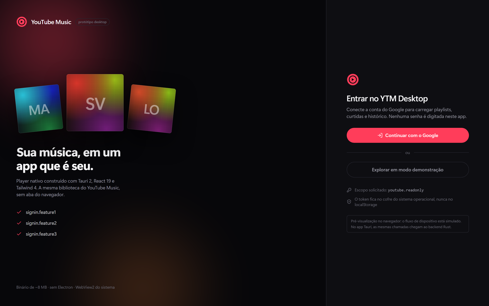
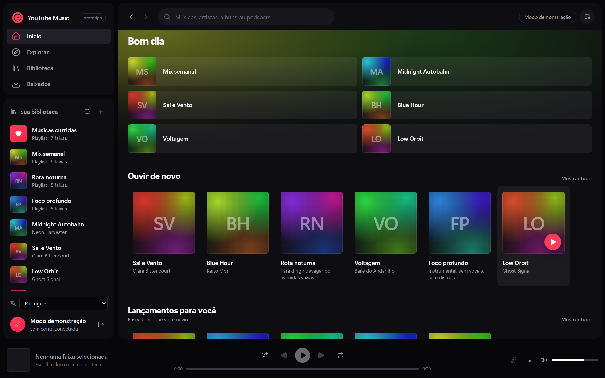
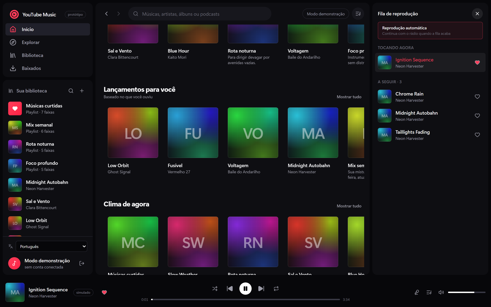
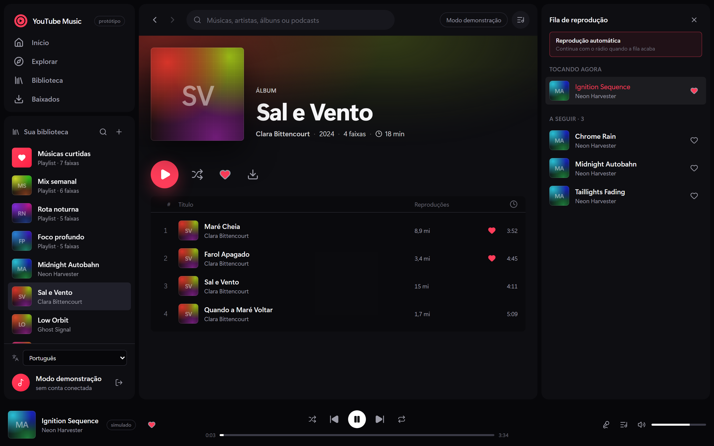
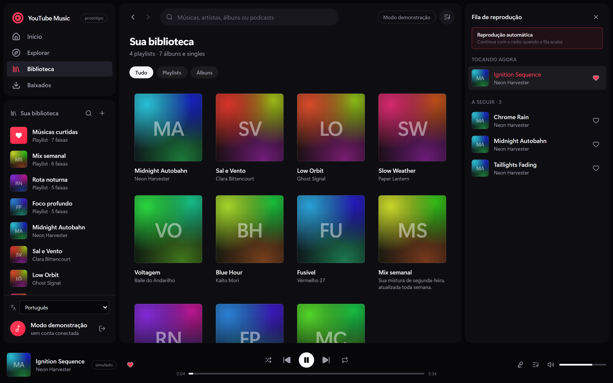
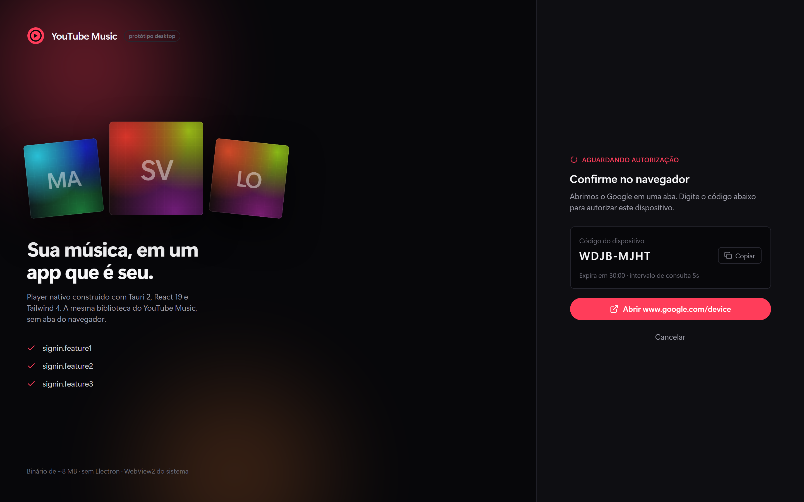
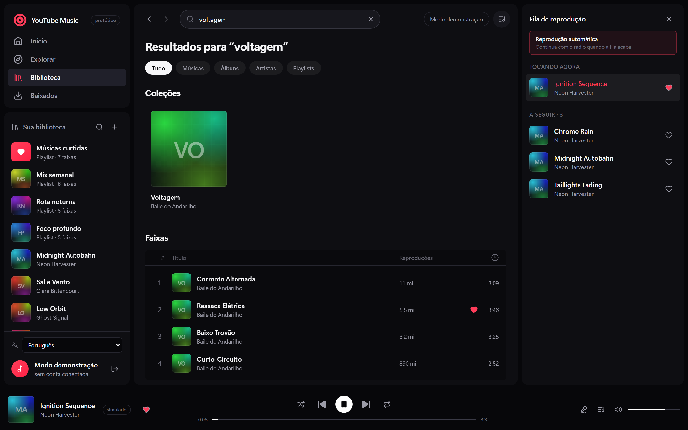
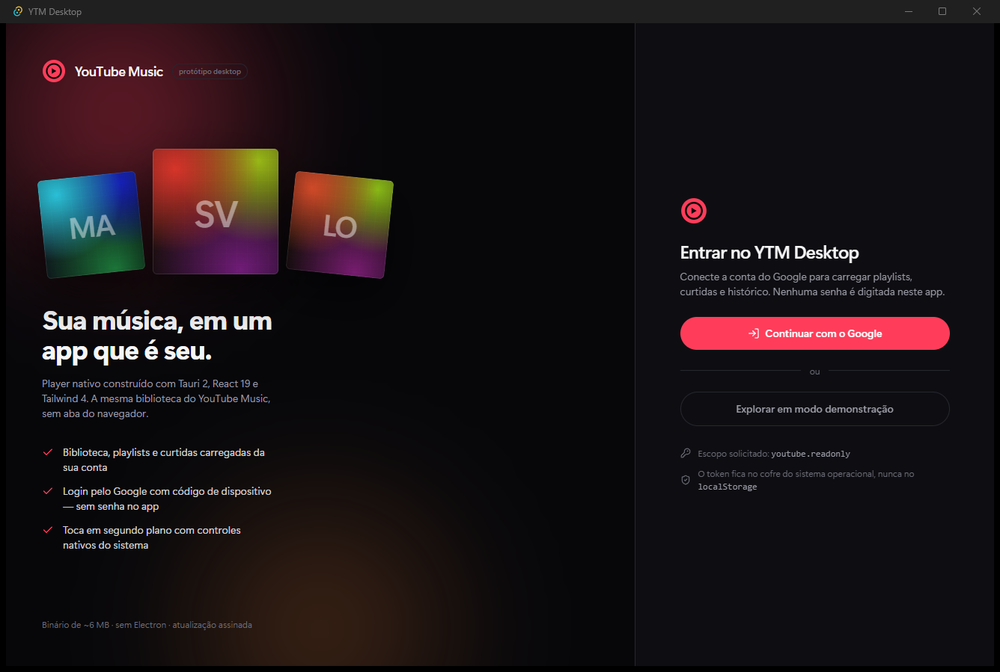

# YTM Desktop

A YouTube Music desktop client prototype — **Tauri 2 + React 19 + Tailwind 4** — built around the
interaction model people already have in their fingers from Spotify.

The point of the project is the surface **plus a real engine behind it**: a dense three-pane desktop
shell, a real transport, a queue, an honest sign-in flow — and, on the desktop build, the actual
YouTube Music catalogue and real streaming audio. Authentication, the catalogue client and the
stream resolver are all implemented end to end in Rust; the browser preview falls back to a bundled
mock catalogue so the UI can be reviewed offline.



| | |
|---|---|
|  |  |
|  |  |
|  |  |

And the same UI inside the actual Tauri window on Windows — not a browser tab:



## What is real and what is not

| Area | Status |
|---|---|
| Playback transport, queue, shuffle, repeat, volume | Real state machine; drives a real `<audio>` sink on desktop |
| Audio | **Real** — each track is resolved through `yt-dlp` to a playable stream |
| Background playback & media keys | **Real** — the Media Session API feeds the OS media overlay and hardware keys |
| Catalogue (home, search, album/playlist pages) | **Real** YouTube Music (InnerTube) on desktop; the preview filters a bundled mock |
| Artwork | Real thumbnails when the response carries them, else a generated sleeve from a hash |
| Search | **Real** catalogue search on desktop, with the web player's result tabs (songs, albums, artists, playlists) |
| Artist pages | **Real** — name, top songs and the artist's rows, from the catalogue |
| Autoplay / radio | **Real** — when the queue ends, the track's radio continues it (toggleable in the queue) |
| Stream cache | Resolved urls are cached until they expire; the next track is prefetched |
| Offline downloads | **Real** — a track is saved to disk with `yt-dlp` and played from the file (asset protocol), so it works without a network |
| Session | The queue, current track and playhead are restored **paused** on the next launch |
| Language | The whole interface is bilingual (pt-BR / English), and the switch also changes the catalogue's data language (`hl`) |
| Sign-in | **Real** OAuth 2.0 device flow in Rust against Google; sign-out revokes the grant |
| Personal library (playlists, liked songs, saved albums) | **Real**, once the browser cookie is connected — InnerTube needs `Cookie` + `SAPISIDHASH`, not a bearer token |
| Liking a track | **Real** — writes through to the account when the library is connected (optimistic, with rollback); local-only otherwise |
| Lyrics | **Real** karaoke — synchronised lines from [LRCLIB](https://lrclib.net) (current line highlighted, click to seek); falls back to the official plain text from YouTube Music when no timing exists. Opening the panel sends the track's artist/title/album to LRCLIB; nothing is sent while it is closed, and nothing is persisted |
| Token / cookie storage | Real OS credential vault (`keyring`: Windows Credential Manager / Keychain / Secret Service) |
| Browser preview (`npm run dev`) | Mock catalogue + simulated transport, labelled as such in the UI |

## Stack

- **Tauri 2** — Rust backend, ~8 MB release binary, no bundled Chromium (uses the system WebView2)
- **React 19** + **TypeScript 6** (strict) — no router, no state library, one reducer for playback
- **Tailwind 4** — CSS-first `@theme` tokens, Vite plugin
- **lucide-react** — icons
- **reqwest / sha1 / keyring** — the Rust side

## Getting started

```bash
npm install

# 1. Review the UI in a browser (mock catalogue, simulated audio)
npm run dev

# 2. Run the real desktop app
npm run tauri dev

# Production build
npm run build && npm run tauri build
```

Only the desktop build talks to Google and to YouTube. In the browser the catalogue and auth
backends are swapped for simulated ones so the flow can be reviewed without credentials — the
screen itself says so.

### Real audio needs yt-dlp

The desktop player streams real audio, which it resolves per track through
[`yt-dlp`](https://github.com/yt-dlp/yt-dlp). Install it and make sure it is on `PATH`:

```powershell
winget install yt-dlp.yt-dlp   # or: pipx install yt-dlp
```

The resolver looks for `$YTM_YTDLP` first, then a `yt-dlp` binary next to the app, then `PATH`. When
none is found the player reports `simulado` on the now-playing bar and falls back to the simulated
transport instead of failing — nothing is silently faked.

## Catalogue and playback

Two private surfaces carry the real product, and both are implemented in Rust:

- **Catalogue** — `src-tauri/src/innertube.rs` speaks to YouTube Music's `WEB_REMIX` InnerTube API
  (`/youtubei/v1/search`, `/browse`). Home, search and album/playlist pages are parsed from the
  renderer tree and handed to the webview as plain JSON. Search and browsing work **without an
  account**.
- **Audio** — `src-tauri/src/stream.rs` turns a track's `videoId` into a time-limited, directly
  playable url through `yt-dlp`. The webview's `<audio>` element streams it with range requests; the
  player's `timeupdate` / `ended` events drive the same reducer the simulated transport uses.

The personal library (liked songs, playlists, saved albums) additionally needs the browser cookie
plus a per-request `SAPISIDHASH` digest. That is the one seam that asks something of you: paste the
`Cookie` header from an authenticated `music.youtube.com` tab on the **Biblioteca** screen. It is
stored only in the OS vault, by Rust, and never enters `localStorage`.

## Authentication

The full write-up is in **[docs/authentication.md](docs/authentication.md)**. The short version:

- The app uses Google's **OAuth 2.0 Device Authorization Grant**. You get a short code, approve it on
  `google.com/device`, and the app polls for a token. No password is ever typed into the app and no
  embedded browser is needed.
- The **refresh token is written only from Rust**, only into the OS credential vault. It never enters
  the webview and never touches `localStorage`.
- The private YouTube Music (InnerTube) endpoints that carry the real library do **not** accept a
  bearer token. They want a browser cookie plus a per-request `SAPISIDHASH` digest. That construction
  lives in `src-tauri/src/auth.rs` and is wired into the catalogue client (`src-tauri/src/innertube.rs`)
  for the personal library — see the trade-offs table in the write-up.

To run the real flow you need your own OAuth client of type *TVs and Limited Input devices*:

```powershell
$env:YTM_GOOGLE_CLIENT_ID     = "000000000000-xxxx.apps.googleusercontent.com"
$env:YTM_GOOGLE_CLIENT_SECRET = "GOCSPX-xxxx"
npm run tauri dev
```

Without them the sign-in screen reports exactly what is missing instead of failing silently. Neither
value is ever committed.

## Keyboard

| Key | Action |
|---|---|
| `Space` | Play / pause |
| `←` `→` | Seek ∓5 s |
| `↑` `↓` | Volume ±5 % |
| `n` / `p` | Next / previous track |
| `m` | Mute |

Ignored while typing in a field or while a button has focus, so nothing hijacks expected behaviour.

## Project structure

```
src/
  App.tsx                  shell: auth gate, view routing, keyboard shortcuts
  types.ts                 domain model, no React
  data/catalog.ts          bundled mock catalogue (browser preview only)
  hooks/useCatalog.tsx     catalogue store: real InnerTube or the mock
  hooks/playerReducer.ts   pure playback state machine (unit-tested)
  hooks/usePlayer.tsx      reducer + the real <audio> sink + Media Session
  hooks/useAuth.tsx        device-flow state machine
  hooks/usePlayCollection.ts
  lib/auth.ts              Tauri IPC boundary + browser fallback
  lib/music.ts             catalogue/stream/rate IPC boundary + browser fallback
  lib/catalog.ts           pure catalogue merge (unit-tested)
  lib/i18n.tsx             bilingual interface (pt-BR / English)
  lib/cover.ts             deterministic artwork from a hash
  components/              Sidebar, TopBar, HomeView, CollectionView,
                           TrackTable, PlayerBar, QueuePanel, SignInScreen,
                           LibraryCookieForm, LyricsPanel, DownloadsView
src-tauri/src/
  auth.rs                  device flow, token + cookie vault, SAPISIDHASH signing
  innertube.rs             real YouTube Music catalogue client (search/browse/home/library/rate)
  browser_cookies.rs       reads the browser cookie store through yt-dlp
  lyrics.rs                timed lyrics (LRCLIB) with a plain-text fallback
  downloads.rs             offline downloads (yt-dlp to disk + an index)
  stream.rs                real audio resolution via yt-dlp
tools/screenshots.mjs      Playwright harness that produced the preview images
tools/e2e.mjs              Playwright harness for the desktop UI (stubbed backend)
vitest.config.ts           unit-test config
```

## Design notes

Declared before the first component was written, and worth stating because the brief was "inspired by
Spotify":

> High-density desktop product UI for people who already live in Spotify. Dark shell, one warm
> YouTube-red accent (`#ff3d5a`), generated rather than photographic surfaces.
> Dials: **variance 4 / motion 4 / density 7**.

Deliberately excluded: purple hero gradients, glassmorphism on every surface, pill-shaped everything,
cream backgrounds, italic accent words. The accent appears only where it earns attention — brand mark,
active navigation, play affordances, the current track, liked hearts.

Artwork is a deterministic mesh gradient derived from the release id, overlaid with a faint grid so the
flat gradients read as printed sleeves. Same input, same sleeve, on every launch, with no binary assets
and no network dependency.

## Verification

```bash
npm run build        # tsc --strict + vite build
npm test             # Vitest: the playback reducer and the catalogue merge
cd src-tauri && cargo test --lib

# Browser-facing: needs a served build and Playwright's Chromium.
npm run preview &
npm run screenshots  # 01-08, mock preview; fails on any console error
npm run e2e          # desktop-mode UI against a stubbed Rust backend
```

The Rust suite is offline and deterministic. Two tests additionally exercise the **live** service —
real search/browse/home against InnerTube, and a real audio url through yt-dlp. They are opt-in so
CI stays hermetic:

```bash
cd src-tauri && YTM_LIVE=1 cargo test --lib
```

`tools/screenshots.mjs` produces `01`–`08` against the production build and exits non-zero on any
console error. `tools/e2e.mjs` injects a fake `__TAURI_INTERNALS__.invoke` before the app loads, so
`isDesktop()` is true and the **desktop-only** UI runs against a stub: it asserts the real catalogue
renders, the missing-yt-dlp banner appears, the connected library loads, search returns backend
tracks, and a like reaches `music_rate`. It writes `10`–`13`. `09-native-window.png` is a one-off
capture of the running binary (`cargo build`, then `PrintWindow` against the window), which is why it
shows real window chrome.

## Accessibility

Semantic roles on the track table, `aria-label` on every icon-only control, one visible focus ring for
the whole app, `aria-live` announcements on track change, `prefers-reduced-motion` honoured, and
keyboard reachability for both actions on each card. Contrast targets WCAG AA on body text and
controls.

## Known advisories

Dependabot reports one moderate advisory against the lockfile, accepted rather than ignored:

| Crate | Advisory | Why it cannot be fixed here |
|---|---|---|
| `glib` 0.18.5 | Unsoundness in the `Iterator` / `DoubleEndedIterator` impls for `glib::VariantStrIter`, fixed in 0.20.0 | `gtk 0.18.2` — pulled in by Tauri's Linux backend through `muda` and `tao` — pins `glib = "^0.18"`, so 0.20.0 is not selectable. Resolution needs an upstream gtk-rs bump in Tauri. |

It is a **Linux-only** dependency. `glib`, `gtk` and `atk` are not compiled for
`x86_64-pc-windows-msvc` or Apple targets, so the Windows and macOS binaries never contain the
affected code. Revisit when Tauri's Linux backend moves to gtk-rs 0.20+.

## License

MIT — see [LICENSE](LICENSE).
