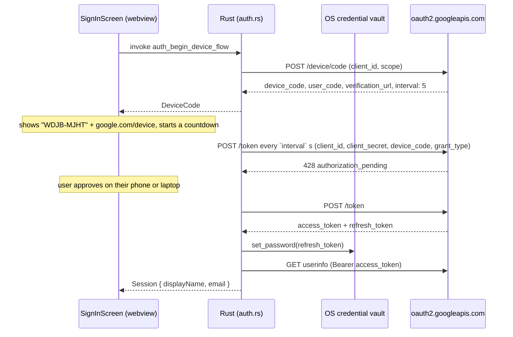

# Authentication

How YTM Desktop signs a user in, what the token actually buys, and where the sharp edges are.

Everything below was checked against Google's own documentation for
[OAuth 2.0 for TV and Limited-Input Device Applications](https://developers.google.com/identity/protocols/oauth2/limited-input-device)
and against the live endpoints. Claims that I could not verify without a real authorized account are
marked **[não verificado]**.

## The problem

YouTube Music has no public API for your library. There are two doors, and they are not
interchangeable:

| | Official OAuth → YouTube Data API v3 | Cookie + `SAPISIDHASH` → InnerTube |
|---|---|---|
| Status | Documented, supported, reviewable | Undocumented internal API |
| Unlocks | Channels, videos, playlists, subscriptions, ratings **of the YouTube account** | The actual YouTube Music library, mixes, moods, YT Music playlists |
| Stability | Versioned contract | Breaks whenever Google changes it |
| Cost | Requires OAuth client + verification for public distribution | Requires the user's browser cookie; effectively a ToS grey zone |
| Shipped here | ✅ yes | ✅ yes — signing wired into the catalogue client for the personal library |

This app implements the first door end to end for sign-in, and the second for the library: the
OAuth device flow proves who you are, and the cookie + `SAPISIDHASH` path is what actually reads
your YouTube Music library. Pretending the first door opens the whole library would be the dishonest
part, so the cookie seam is explicit and lives behind its own screen.

## The flow that is implemented

Google's **Device Authorization Grant**. The user never types a password into this app and the app
never opens an embedded browser.



Restarting the app runs `auth_restore_session`, which exchanges the stored refresh token for a new
access token. A revoked grant clears the vault entry and returns to the signed-out screen instead of
erroring — a normal outcome, not a failure.

### Outcomes the poll has to handle

The status code is *not* the discriminator, which is why `auth_poll_device_flow` parses the body first:

| Body `error` | HTTP | Meaning | Treatment |
|---|---|---|---|
| `authorization_pending` | 428 | User has not decided yet | Keep polling |
| `slow_down` | 403 | Polling too fast | Back off; the UI adds +5 s to the interval |
| `access_denied` | 403 | User refused | Terminal, with a retry affordance |
| `expired_token` / `invalid_grant` | 400 | Code dead or already claimed | Terminal, offer a new code |
| `invalid_client` | 401 | Wrong client id, or the wrong client **type** | Terminal, surfaced verbatim |
| `invalid_request` | 400 | Missing parameter | Terminal — see the gotcha below |

**Gotcha, found by testing rather than by reading:** the token poll *requires* `client_secret`, even
though these clients ship to end-user devices and Google's own page states that such apps "cannot keep
secrets". Omitting it fails with
`400 invalid_request: Missing required parameter: client_secret`. `poll_form()` in `auth.rs` carries it,
and `poll_form_carries_the_client_secret` is the regression test for exactly that mistake.

## What the token does and does not buy

With `https://www.googleapis.com/auth/youtube.readonly` the app can call YouTube Data API v3
endpoints such as `channels.list?mine=true`, `playlists.list?mine=true`, `subscriptions.list` and
`ratings.list`.

It does **not** give the YouTube Music library surface: YT Music playlists, personalised mixes, moods
and the YT Music catalogue structure are served by InnerTube. **[não verificado]** The exact overlap —
for example whether the account's YT Music "Liked Music" is reachable as a Data API playlist for a
given account — needs a real authorized account to confirm. Treat it as unknown until you check.

`youtube.readonly` is a **sensitive scope**. During development you will see an "unverified app"
warning on the consent screen. Distributing publicly means passing Google's verification review.

## Storage and threat model

The rule: **the token is written only from Rust, and only into the OS credential vault.**

- Vault access is `keyring` (`Entry::new` / `set_password` / `get_password` / `delete_credential`),
  which maps to Windows Credential Manager, macOS Keychain, or Secret Service on Linux.
- The refresh token never enters the webview. There is no `localStorage` write for it anywhere.
- The webview is told nothing but a display name and an email; `invoke` returns `Session`, never a
  token.
- The desktop CSP pins `connect-src 'self' ipc:` — the webview cannot talk to Google even if injected
  script tried. All network egress goes through Rust.
- **No credentials are committed.** `YTM_GOOGLE_CLIENT_ID` and `YTM_GOOGLE_CLIENT_SECRET` are read from
  the environment at call time. Absent them, the UI reports precisely what is missing.

What this does *not* protect against: anyone who can run code as your user can read the vault entry,
and a distributed build embeds the client secret in the binary — inherent to this Google flow, not a
choice this prototype made. Treat the client secret as public and never reuse it for anything else.

## Configuration

1. Google Cloud Console → **APIs & Services** → enable **YouTube Data API v3**.
2. **Credentials** → *Create client* → application type **TVs and Limited Input devices**.
3. Export both values and run the desktop app:

```powershell
$env:YTM_GOOGLE_CLIENT_ID     = "000000000000-xxxx.apps.googleusercontent.com"
$env:YTM_GOOGLE_CLIENT_SECRET = "GOCSPX-xxxx"
npm run tauri dev
```

Sign out is `auth_sign_out`, which deletes the vault entry. To revoke on Google's side as well, the
account page is <https://myaccount.google.com/permissions>; the endpoint `POST
https://oauth2.googleapis.com/revoke?token=<refresh_token>` would do it programmatically and is the
natural next step.

## Browser preview

Outside Tauri, `src/lib/auth.ts` swaps the IPC calls for a simulated backend: the same state machine,
the same screens, a fixed code (`WDJB-MJHT`) that resolves after two polls. The sign-in screen labels
the mode so a screenshot can never be mistaken for a real session.

## UI constraints from the specification

Google states two things the interface must handle, both honoured in `SignInScreen.tsx`:

- The `user_code` field must accommodate 15 `W` characters, and the code is case-sensitive — it is
  rendered verbatim (copy writes the raw value, not the letter-spaced display) with no case changes.
- The `verification_url` display must accommodate 40 characters and may only be modified by stripping
  the scheme, which is what the button label does.

## Where the code lives

| Concern | File |
|---|---|
| Device flow, token exchange, refresh, cookie vault, headers | `src-tauri/src/auth.rs` |
| Catalogue client that consumes the cookie + signature | `src-tauri/src/innertube.rs` |
| Reading the cookie out of the browser (via `yt-dlp`) | `src-tauri/src/browser_cookies.rs` |
| Commands exposed to the webview | `src-tauri/src/lib.rs` |
| IPC boundary and the browser fallback | `src/lib/auth.ts`, `src/lib/music.ts` |
| Flow state machine (polling, countdown, cancellation) | `src/hooks/useAuth.tsx` |
| The screen itself | `src/components/SignInScreen.tsx` |
| Where the cookie is entered or imported | `src/components/LibraryCookieForm.tsx` |
